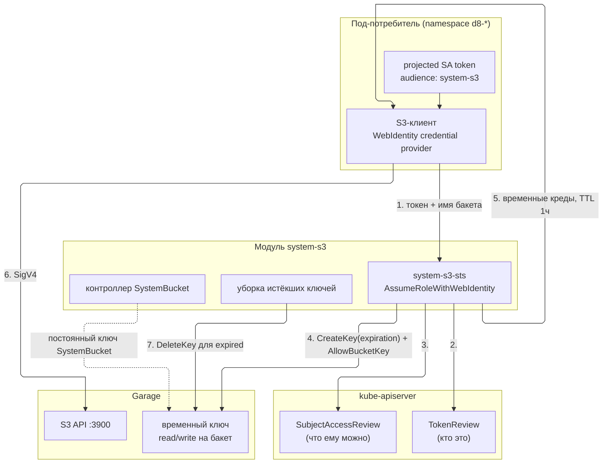
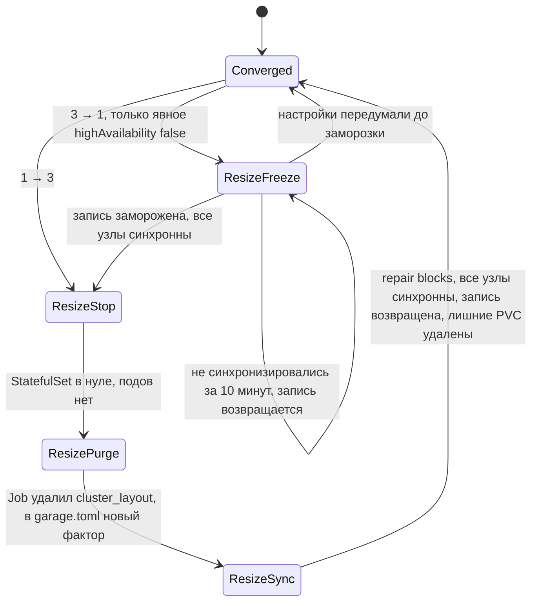
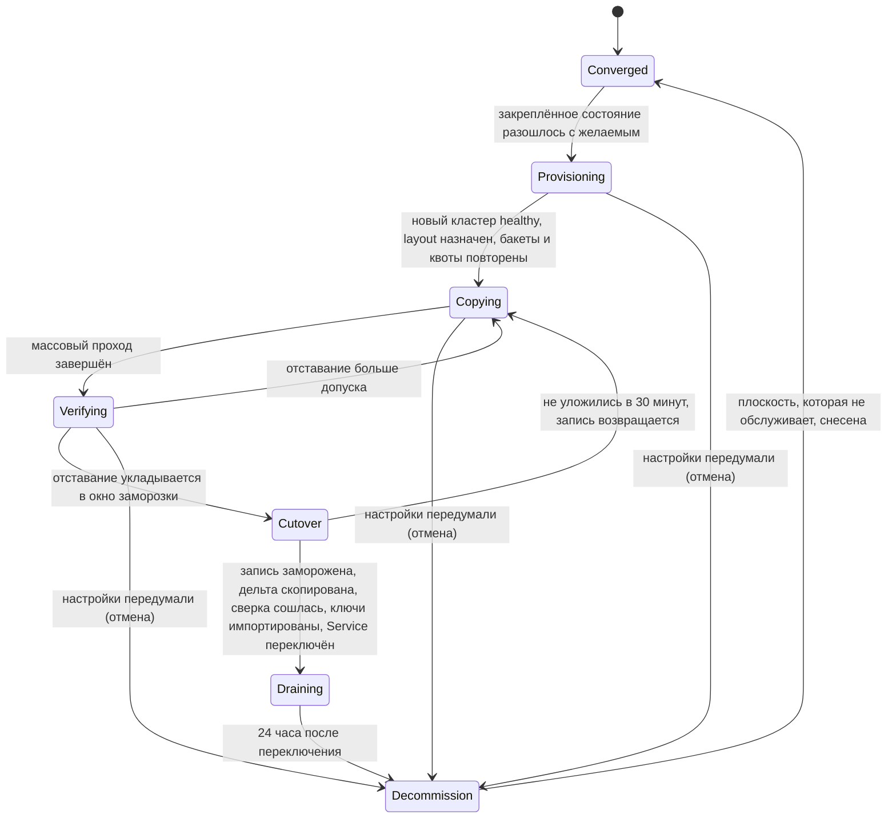

# system-s3: переход на StorageClass, ёмкость от бакетов, HA-режим, JWT-доступ

Статус: черновик плана, к обсуждению. Дата: 2026-09-16. Версия Garage: 2.3.0 (`oss.yaml`).

Документ описывает восемь связанных изменений, порядок их внедрения, и то, что каждое
из них ломает. Читать сверху вниз: решения в §1–§6 определяют, каким получается план
миграции (§7) и поведение при изменении числа мастеров (§8).

## 0. Где модуль сейчас

Факты из кода, на которые опирается план:

| Что | Как сейчас | Где |
|---|---|---|
| Хранилище данных | статический пул hostPath-PV на control-plane узлах, которые создаёт сам контроллер; `StorageClass system-s3-local` (`no-provisioner`, `WaitForFirstConsumer`, `Retain`) | `internal/backend/garage/local_pv.go`, `templates/system-storageclass.yaml` |
| Размер тома | `storage.sizePerNode` (по умолчанию 10Gi), номинальный — hostPath его не соблюдает | `openapi/config-values.yaml`, `resources.go:buildLocalPV` |
| Число реплик | константы `replicasHA=3` / `replicasSingle=1`, переключаются `storage.singleReplica` | `resources.go:desiredReplicas` |
| Смена числа реплик | `replication_factor` в Garage неизменяем на живом кластере → полный teardown + пересоздание пустого хранилища, под подтверждение `storage.recreateConfirmation` | `garage.go:EnsureStore`, `recreate.go` |
| Ёмкость Garage | `capacity` роли в layout = `sizePerNode` | `mesh.go:layoutRoleChanges` |
| Квота бакета | нет: у `SystemBucket` нет поля размера, в admin-клиенте нет вызова квот | `crds/systembucket.yaml`, `admin.go` |
| Доступ к бакету | один статический ключ SigV4 на `SystemBucket`, секрет рядом с ресурсом | `access.go`, `system_bucket_controller.go` |
| Ротация ключа | только вручную: аннотация `storage.deckhouse.io/rotate` | `system_bucket_controller.go` |
| Перемещение реплик | пересоздание PVC (данные реплики теряются, Garage восстанавливает их anti-entropy) | `rebalance.go` |

Ключевые следствия текущей схемы, которые и являются причиной переделки:

- данные привязаны к диску узла: пересоздание мастера = потеря копии, а в
  single-replica — потеря всего хранилища;
- заявленный размер ничего не ограничивает: и место на узле, и потребление бакетами
  не контролируются;
- переключение режима реплик разрушает данные, и единственная защита — строка
  подтверждения в ModuleConfig;
- потребитель получает вечный ключ и читает его через `envFrom` (см. `docs/USAGE.md`),
  то есть ротация ключа ломает потребителя.

## 0.1. Принятые решения (16.09.2026)

- **StorageClass обязателен.** Запасного пути на локальные диски нет: без класса
  data plane не разворачивается, `StorageReady=False`, алерт. Значит, весь
  hostPath-пул из модуля удаляется.
- **Права в JWT-доступе** — через подресурсы `systembuckets/read` и
  `systembuckets/write`.
- **Старый кластер после cutover** живёт 24 часа и сносится автоматически.
- **`SystemBucket.spec.size`** — по умолчанию `1Gi` для всех; существующих ресурсов,
  которые надо щадить, нет.
- **Авторотация вводится безусловно**: потребители проектируются от спецификации
  модуля и обязаны перечитывать ключ, исключений для отдельных бакетов не делается.
- **Размещение data plane**: предпочтительно системные узлы, при их отсутствии или
  нехватке места — мастера (§1).
- **Классы в e2e**: csi-huawei (сетевой) и sds-local-volume (локальный), §13.
- **Garage поднимается до v2.4.1** (последний upstream-тег, 08.09.2026) в рамках этой
  работы.
- **`replication_factor` на живом кластере не меняется** — проверено многократно,
  это предпосылка, а не гипотеза: любое изменение RF = новый кластер + миграция (§7).

Что из этого следует для объёма работ: пункт про запасной путь убирает из модуля
целый слой (`local_pv.go`, сборка мусора по PV, привязка incarnation к каталогам на
узле, `templates/system-storageclass.yaml`, ограничение кэша PV-информера в `main.go`).

## 0.2. Что уже умеет admin API Garage (сверено со спецификацией v2.4.1)

Спецификация `doc/api/garage-admin-v2.json` у v2.3.0 и v2.4.1 совпадает (49 вызовов,
те же схемы), то есть повышение версии не требует правок клиента. Важное, чего в
нашем `admin.go` сейчас нет, а в API есть:

| Вызов / поле | Что даёт плану |
|---|---|
| `UpdateBucket` → `quotas.maxSize` / `maxObjects` | квота бакета из `spec.size` (§2) |
| `GetBucketInfo` → `bytes`, `objects`, `unfinishedMultipartUploadBytes` | метрики заполнения, алерты и сверка копий перед cutover (§2, §7) |
| `CreateKey` / `UpdateKey` → `expiration` (RFC 3339), `neverExpires` | **срок жизни ключа обеспечивает сам Garage**: STS-ключи истекают без нашего сборщика, а старый ключ при ротации гасится ровно по окончании окна перекрытия (§3, §4) |
| `ImportKey` (`accessKeyId` + `secretAccessKey`) | **миграция без смены кредов**: обе половины ключа лежат у нас в Secret потребителя, значит, в новом кластере создаётся ключ с тем же идентификатором и секретом (§7) |
| `DenyBucketKey` | заморозка записи на время дельта-прохода (§7) |
| `ListKeys` → `expired` | уборка истёкших ключей без собственного состояния (§4) |
| `ClusterLayoutSkipDeadNodes`, `PreviewClusterLayoutChanges` | корректный выход из layout для узла, который не вернётся (§8) |
| `CreateAdminToken` (токены admin API с областью действия) | STS-сервису не нужен полный admin-токен кластера (§4) |
| `/metrics` на admin-порту | Garage отдаёт свои метрики Prometheus — заполнение и состояние берутся из первоисточника, а не только из наших gauge (§2) |
| `CleanupIncompleteUploads`, `CreateMetadataSnapshot` | вне текущего объёма, но пригодится: незавершённые multipart искажают учёт места, снимок метаданных — основа для резервной копии |

## 1. PVC из StorageClass вместо hostPath-пула

### Решение

Данные Garage переезжают на обычные PVC из `StorageClass`, который выбирается по
цепочке (как в upmeter, через общий хук `module-sdk/common-hooks/storage-class-change`):

```
systemS3.storageClass  →  global.modules.storageClass  →  default StorageClass кластера
```

Эффективное значение вычисляется хуком и кладётся в
`systemS3.internal.effectiveStorageClass`; чарт передаёт его контроллеру через уже
существующий env `STORAGE_CLASS`, контроллер — в `volumeClaimTemplates` StatefulSet.

Новый параметр ModuleConfig:

```yaml
storageClass:
  oneOf:
    - type: string
    - type: boolean
      enum: [false]
  description: |
    StorageClass, из которого заказываются тома системного объектного хранилища.
    Если не задан — берётся global.modules.storageClass, затем StorageClass по
    умолчанию в кластере.
```

### Что важно сделать не так, как в upmeter

Общий хук из `module-sdk` при смене класса **удаляет PVC и StatefulSet** — для upmeter
это приемлемо (база метрик доступности), для системного S3 это потеря данных платформы.
Поэтому:

- берём из общего хука только вычисление `effectiveStorageClass` (собственный хук
  `hooks/go/040-storage-class/`, логика `calculateEffectiveStorageClass` переносится
  один-в-один, деструктивная часть — нет);
- смену класса обрабатывает контроллер тем же механизмом, что и смену HA-режима:
  это миграция между кластерами Garage (§7), а не удаление томов.

### Класса нет — модуля нет

Запасного пути нет: какой-то `StorageClass` в кластере должен быть всегда. Если ни
модульный параметр, ни `global.modules.storageClass`, ни default-класс не дают имени
класса, data plane не разворачивается: `StorageReady=False` с сообщением «не выбран
StorageClass», метрика и алерт. Уже работающее хранилище в этой ситуации не трогается
(класс не может «пропасть» у связанных PVC), речь только про первую установку.

`emptyDir`, на который в такой ситуации переходит upmeter, здесь неприменим:
перезапуск пода — потеря объектов платформы.

Прямое следствие решения — из модуля уходит весь слой локальных томов: пул
hostPath-PV и его сборка мусора (`local_pv.go`), привязка incarnation к каталогам на
узле (`localPVPath`), `templates/system-storageclass.yaml` вместе с классом
`system-s3-local`, метка `LocalNodeLabel` и ограничение PV-информера в `main.go`.

### Топология класса решает больше, чем его имя

Дальше по документу два типа классов различаются, потому что от этого зависит всё
поведение при переезде реплик:

- **сетевой (shared)** — том переезжает за подом на другой узел (csi-ceph, csi-nfs,
  csi-hpe и подобные);
- **локальный (node-local)** — том привязан к узлу (sds-local-volume, local-path,
  сегодняшний hostPath-пул).

Определять тип предлагается по факту: у связанного PV непустой `spec.nodeAffinity` →
класс локальный. Значение кладётся в `StoreState` и печатается в логе/условии, потому
что из него следуют разные сценарии в §8.

### Где теперь живёт data plane

Пока данные лежали на дисках мастеров, вопроса не было. С обычными PVC он появляется,
и политика такая: **предпочтительно системные узлы; если их нет или реплика на них не
помещается — мастера.** Иначе системное хранилище занимает ресурсы control-plane там,
где в кластере есть выделенные системные узлы.

В Kubernetes это ровно две вещи в PodSpec:

```yaml
affinity:
  nodeAffinity:
    # кандидаты: системные узлы ИЛИ мастера, и больше никто
    requiredDuringSchedulingIgnoredDuringExecution:
      nodeSelectorTerms:
        - matchExpressions: [{key: node-role.deckhouse.io/system, operator: Exists}]
        - matchExpressions: [{key: node-role.kubernetes.io/control-plane, operator: Exists}]
    # предпочтение: системные
    preferredDuringSchedulingIgnoredDuringExecution:
      - weight: 100
        preference:
          matchExpressions: [{key: node-role.deckhouse.io/system, operator: Exists}]
```

плюс tolerations на оба класса узлов: `dedicated.deckhouse.io=system`,
`dedicated.deckhouse.io=system-s3` (как в `_helm_lib_system_tolerations`) и
`node-role.kubernetes.io/control-plane` / `node-role.kubernetes.io/master`.

Готового помощника в lib-helm под эту форму нет: стратегия `system` в
`helm_lib_node_selector` выдаёт жёсткий `nodeSelector` на системные узлы, а `master`
уходит на системные только когда мастеров нет вовсе — «предпочтительно A, иначе B»
ни та, ни другая не выражает. Affinity пишется руками, tolerations берутся
объединением готовых наборов.

Два следствия, которые надо держать в голове:

- **класс обязан уметь давать тома и на системных узлах, и на мастерах.** Для
  локальных классов (sds-local-volume) это значит диски и `LVMVolumeGroup` на обеих
  группах узлов, и **обязательно** `volumeBindingMode: WaitForFirstConsumer` — при
  `Immediate` том выделяется до выбора узла, и «предпочтение» превращается в
  жёсткую привязку к тому, что выделилось;
- **размещение и HA-режим — разные вещи.** HA выводится из числа мастеров
  (`clusterControlPlaneIsHighlyAvailable`), а живут реплики там, где сказано выше.
  Появление системных узлов меняет размещение, но не число реплик.

Отсюда же правка в §8: понятие «control-plane узлы» в коде (`controlPlaneHostnames`,
ограничение информера Node в `main.go`, правила SPREAD/CONSOLIDATE) заменяется на
«узлы-кандидаты» — объединение системных и мастеров.

### Затрагиваемые файлы

- `openapi/config-values.yaml`, `openapi/values.yaml` (`internal.effectiveStorageClass`),
  `openapi/doc-ru-config-values.yaml`;
- новый хук `hooks/go/040-storage-class/`;
- `templates/controller/controller.yaml` (`STORAGE_CLASS` из internal-значения),
  `templates/system-storageclass.yaml` (условный рендер, только для fallback);
- `internal/backend/garage/local_pv.go` (остаётся только под fallback),
  `resources.go` (`buildStatefulSet`, `buildLocalPV`), `rebalance.go`
  (`systemReplicaNodes` больше не может читать узел из метки PV пула —
  для сетевого класса узел реплики берётся из пода).

## 2. Ёмкость = сумма заказанных SystemBucket

### Решение

`storage.sizePerNode` убирается. Вместо него:

1. у `SystemBucket` появляется `spec.size` (Quantity, по умолчанию `1Gi`) — сколько
   бакет просит;
2. контроллер выставляет это значение квотой бакета в Garage: `UpdateBucket` с
   `quotas.maxSize` (в спецификации admin API v2 это есть, добавить вызов в `admin.go`),
   а `GetBucketInfo` отдаёт `bytes` и `objects` — отсюда берутся и заполнение в статусе,
   и метрики, и сверка при миграции;
3. размер тома каждой реплики и `capacity` роли в layout считаются из суммы:

```
Σ = Σ spec.size по всем живым SystemBucket
том реплики = ceil( max(Σ * (1 + headroom) + metaReserve, floor) / step ) * step
```

со стартовыми значениями `headroom = 20%`, `metaReserve = 2Gi`, `floor = 10Gi`,
`step = 5Gi`. Шаг нужен, чтобы бакет на гигабайт не вызывал расширение тома каждый
раз; `floor` — чтобы кластер Garage не поднимался на томе, где ему негде развернуть
метаданные.

Почему «на реплику», а не «делённое на реплики»: при RF=3 и трёх узлах каждый узел
держит полную копию данных, поэтому том каждой реплики должен вмещать всю сумму.

### Автоматическое расширение

Расширение PVC требует двух вещей:

- `allowVolumeExpansion: true` у класса — если класс этого не умеет, расширение
  невозможно: контроллер сообщает об этом в `StorageReady` и метрикой, новые
  `SystemBucket` остаются `Pending` с внятным сообщением, уже работающие не трогаются;
- `volumeClaimTemplates` у StatefulSet неизменяемы (в версиях Kubernetes, на которых
  работает DKP; проверить на целевой версии) — поэтому расширение делается так:
  1. StatefulSet удаляется с `--cascade=orphan` (поды живут),
  2. каждому PVC патчится `spec.resources.requests.storage`,
  3. StatefulSet создаётся заново с новым шаблоном,
  4. после того как у PVC `status.capacity` догнал запрос, обновляется `capacity`
     роли в layout Garage.

Шаги идемпотентны и переживают рестарт контроллера: желаемый размер хранится там же,
где сейчас лежит incarnation — в ConfigMap `system-garage-config`.

Сужение не делается никогда: PVC не умеет уменьшаться. Удаление бакета уменьшает Σ и
квоты, но не том. Это надо записать в контракт (`docs/`).

### Что ещё меняется

- `SystemBucket.status` получает `capacity`/`usedBytes` (Garage отдаёт использование
  бакета в `GetBucketInfo`), метрики по бакету и алерт «бакет заполнен на 80/95%»;
- вебхук `SystemBucket` проверяет, что `spec.size` не уменьшается ниже уже
  использованного (уменьшение квоты ниже занятого Garage примет, но запись встанет);
- `sizePerNode` уходит из `config-values.yaml`, `config.go`, `backend.Store`,
  `mesh.go`, `resources.go`, `controller.yaml`, `hack/helm-render-values.yaml`.

## 3. Авторотация ключей раз в сутки

### Решение

Ротация становится автоматической: `rotationInterval = 24h`, плюс окно перекрытия
`rotationGracePeriod = 1h`, в течение которого старый ключ ещё работает.

Механика (в терминах существующего кода в `system_bucket_controller.go`):

- в статус добавляется `nextRotationTime`; reconcile возвращает
  `RequeueAfter = nextRotationTime - now`, а по наступлении срока выставляет
  `mintFresh = true` — то есть переиспользуется весь существующий путь ротации;
- **окно перекрытия обеспечивает сам Garage**: вместо того чтобы отзывать старый ключ
  «на следующем проходе», контроллер вызывает `UpdateKey` с
  `expiration = now + rotationGracePeriod`. Дальше ключ гаснет в бэкенде точно в срок,
  даже если контроллер в этот момент лежит, а `status.supersededAccessKeyID` нужен уже
  только для того, чтобы убрать истёкший ключ из Garage (в `ListKeys` он виден с
  `expired: true`);
- аннотация `storage.deckhouse.io/rotate` остаётся как «ротация прямо сейчас».

Отдельно это снимает старую проблему: сегодня отзыв старого ключа зависит от того,
доживёт ли контроллер до следующего прохода, и при неудаче ключ остаётся вечным.

### Контракт для потребителей

Потребители системного хранилища проектируются от этой спецификации, а не наоборот:
**перечитывать креды — обязанность потребителя**, и авторотация вводится без оглядки
на существующие привычки. Исключений (аннотации «не ротировать этот бакет») не будет:
исключение превращает ежедневную ротацию из свойства платформы в пожелание.

Что из этого записывается в `docs/USAGE.md` как требование:

- секрет монтируется файлами (`volumes.secret`), а не через `envFrom`: переменные
  окружения в работающем поде не обновляются, содержимое примонтированного секрета
  kubelet обновляет сам;
- клиент перечитывает креды при получении `403`/`InvalidAccessKeyId` и повторяет
  запрос — этого достаточно, чтобы пережить ротацию, даже если файл ещё не обновился
  в момент смены (на это и рассчитано окно перекрытия в час);
- предпочтительный путь для нового потребителя — STS из §4: там креды короткоживущие
  по устройству и ротация ему не нужна вовсе.

Сегодняшний `docs/USAGE.md` предлагает ровно то, что теперь запрещено (`envFrom:
secretRef`), — переписать его часть работы MR4.

## 4. Авторизация в бакетах по JWT (права раздаются через RBAC Kubernetes)

### Ограничение бэкенда

Garage умеет только SigV4 со статическими ключами: в admin API v2 (сверено со
спецификацией v2.4.1) нет ни одного вызова, связанного с OIDC, STS или bearer-токенами
для S3 — управление доступом там сводится к ключам и правам ключа на бакет. Значит,
мост между JWT Kubernetes и S3 пишем мы.

### Вариант A (рекомендуется): STS-эндпоинт AssumeRoleWithWebIdentity

Новый компонент `system-s3-sts` — HTTP-сервис в том же поде контроллера
(отдельный listener и Service), реализующий совместимый с AWS STS вызов
`AssumeRoleWithWebIdentity`.



Детали:

1. **Кто это.** Потребитель монтирует projected-токен ServiceAccount с audience
   `system-s3`; STS проверяет его через `TokenReview` (не локальной проверкой подписи —
   TokenReview учитывает отзыв токена и удаление ServiceAccount).
2. **Что ему можно.** `SubjectAccessReview` от имени субъекта токена на подресурсы
   `systembuckets/read` и `systembuckets/write` (verb `get`), с именем и namespace
   запрошенного бакета. Подресурсы, а не `get`/`update` на самом ресурсе: право читать
   объекты в бакете не должно быть тем же правом, что править сам `SystemBucket`.
   **Это и есть «раздавать права через k8s»**: администратор выдаёт доступ обычными
   `Role`/`RoleBinding`, своих CRD прав не требуется. Подресурсы виртуальные — они
   существуют только как строка в SAR, API-сервер их не обслуживает, и это законный
   приём (так же устроены `pods/exec` в чужих реализациях авторизации).
3. **Ключ.** STS создаёт ключ Garage через `CreateKey` **с полем `expiration`**
   (RFC 3339) и правами по результату SAR. Срок жизни ключа обеспечивает сам Garage:
   по истечении ключ перестаёт работать, даже если наш контроллер недоступен. Уборка
   сводится к удалению ключей, которые `ListKeys` показывает с `expired: true`, —
   собственного состояния для этого не нужно.
4. **TTL** по умолчанию 1 час (запрос допускает 15 мин…12 ч), количество живых
   STS-ключей ограничено сверху (ключ Garage — запись в метаданных кластера).
5. **Клиенты.** Механизм штатный: `stscreds.NewWebIdentityRoleProvider` в aws-sdk-go-v2,
   `credentials.NewSTSWebIdentity` в minio-go. Потребителю достаточно переменных
   окружения `AWS_WEB_IDENTITY_TOKEN_FILE`, `AWS_ROLE_ARN` и адреса STS — то есть
   рецепта в `docs/USAGE.md`, а не своей библиотеки.

Плюсы: данные идут напрямую в Garage (нет прокси на пути данных); креды короткоживущие,
так что §3 для таких потребителей теряет смысл; отзыв прав — это удаление RoleBinding,
эффект в пределах TTL.

Минусы: отзыв не мгновенный (живой ключ доживает до истечения, максимум TTL); нужен
собственный STS-совместимый эндпоинт (XML-ответ AWS STS) и его e2e.

### Вариант B: S3-прокси с проверкой на каждый запрос

Прокси перед Garage: принимает запрос, проверяет JWT и SAR на каждом вызове,
подписывает запрос к Garage внутренним ключом.

Плюсы: мгновенный отзыв прав, нет жизненного цикла ключей, права проверяются
пообъектно. Минусы: прокси **на пути данных** (пропускная способность и задержка
системного хранилища становятся нашей проблемой), и клиенты S3 не умеют слать
bearer-токен — приходится идти на трюк «SigV4, где секрет — это сам JWT», что
требует нестандартной настройки у каждого потребителя.

**Рекомендация:** A. B держать в уме как путь для случая, когда понадобится мгновенный
отзыв или пообъектные права.

### Совместимость

Статический ключ в секрете рядом с `SystemBucket` остаётся: часть потребителей его уже
использует, и не у всех есть возможность ходить в STS. Два пути сосуществуют,
рекомендованным в документации становится STS.

## 5. Число реплик от HA-режима

`storage.singleReplica` заменяется на стандартный для платформы HA-режим:
`helm_lib_is_ha_to_value` уже умеет цепочку
`<модуль>.highAvailability → global.highAvailability → global.discovery.clusterControlPlaneIsHighlyAvailable`,
поэтому в ModuleConfig добавляется только переопределение:

```yaml
highAvailability:
  type: boolean
  description: |
    Ручное управление режимом отказоустойчивости. По умолчанию берётся из
    global.highAvailability, а при его отсутствии — из числа control-plane узлов.
```

Отображение: HA → 3 реплики, `replication_factor: 3`; не-HA → 1 реплика,
`replication_factor: 1`. То есть `desiredReplicas`/`replicationFactor` в `resources.go`
перестают читать `store.SingleReplica` и начинают читать `store.HighAvailability`,
которое чарт передаёт env-переменной `HIGH_AVAILABILITY` (вместо `SINGLE_REPLICA`).

**Важное следствие, которое нужно обработать явно.** Производное значение HA меняется
само, когда меняется число мастеров. Схема «реплики привязаны к HA-режиму» без защиты
означает: потеряли два мастера — модуль решил, что теперь не-HA, и перестроил
хранилище на одну реплику. Поэтому:

- действующее значение HA **закрепляется** в ConfigMap data plane (там же, где
  `replication_factor` и incarnation) — ровно так, как сейчас закреплён RF;
- расхождение «закреплено 1, желаемо 3» (появились мастера, выросла отказоустойчивость)
  запускает миграцию §7 автоматически;
- расхождение «закреплено 3, желаемо 1» (мастеров стало меньше) **само не выполняется
  никогда**: реплики консолидируются на выживший мастер (§8), а переход на RF=1
  происходит только если оператор явно написал `highAvailability: false` в ModuleConfig.

## 6. Что уходит из ModuleConfig и как это пережить

Убираются: `storage.singleReplica`, `storage.sizePerNode`, `storage.recreateConfirmation`
(вся секция `storage`). Добавляются: `storageClass`, `highAvailability`.

Это несовместимое изменение схемы настроек, поэтому:

- `openapi/config-values.yaml` получает `x-config-version: 2`;
- появляется `openapi/conversions/v2.yaml`, которая удаляет секцию и переносит
  смысл: `storage.singleReplica: true` → `highAvailability: false`
  (`storage.singleReplica: false` → ничего, чтобы не зафиксировать HA жёстко там,
  где он должен выводиться из кластера); `storage.sizePerNode` и
  `storage.recreateConfirmation` — удалить.

Пример (конверсии — это jq-выражения, применяются по цепочке версий; механизм
работает и для внешних модулей: `applyValuesConversions` вызывается контроллером
ModuleRelease):

```yaml
version: 2
conversions:
  - if .storage.singleReplica == true then .highAvailability = false end | del(.storage)
description:
  ru: "Секция `storage` удалена: `singleReplica` заменён на `highAvailability`, размер тома вычисляется из суммы размеров SystemBucket, подтверждение пересоздания больше не нужно — переключение режима выполняется миграцией без потери данных."
  en: "..."
```

`storage.singleReplica: false` намеренно не переносится в `highAvailability: true`:
значение по умолчанию должно и дальше выводиться из кластера, а не быть зафиксированным
конверсией. К конверсии пишется тест с `testdata/v1-1.yaml` и `v2-1.yaml` — так это
описано в документации по структуре модуля.

Модуль в стадии `Experimental`, поэтому ломающее изменение допустимо, но конверсия
всё равно нужна: без неё ModuleConfig с полями старой схемы не пройдёт валидацию и
модуль перестанет конфигурироваться (этот класс отказа в модуле уже случался —
см. комментарий в `hooks/go/openapischema/validations_test.go`).

## 7. Миграция между кластерами Garage

### Зачем

`replication_factor` в Garage нельзя изменить на живом кластере — это проверено
многократно и лежит в основании сегодняшнего `recreate`-пути. Значит, любое из трёх
событий требует **нового кластера Garage**:

- переключение HA-режима (RF 1↔3);
- смена StorageClass (тома надо заказать заново из другого класса);
- (как побочный эффект) восстановление после потери incarnation.

Сегодня это делается разрушением данных под строку-подтверждение. Раз подтверждение
убирается (§6), переключение обязано стать неразрушающим — то есть миграцией.

**Уточнение от 28.09.2026: HA-режим меняется на месте, миграция осталась только для
класса.** «Нельзя изменить на живом кластере» оказалось верным буквально: Garage
отказывается стартовать, если `replication_factor` расходится с сохранённым layout
(`rpc/layout/manager.rs`), и сам подсказывает выход — удалить `meta/cluster_layout`.
Идентичность узла и данные при этом остаются, кластер собирает новый layout на тех же
метаданных и блоках, а недостающие копии Garage досинхронизирует сам. Проверено руками
в обе стороны на 2 ГиБ со сверкой sha256 каждого объекта. Контроллер делает это фазами той же машины
состояний, без второй плоскости (`images/controller/internal/backend/garage/resize.go`):



Синхронность — по `GetNodeStatistics` со всех узлов (ответили все, очереди таблиц
пусты, ошибок досинхронизации блоков нет) и по томам: на каждом узле файлов блоков не
меньше, чем `rcEntries`, то есть блоков, на которые узел знает ссылки. Очередь
досинхронизации блоков для этого не годится: каждая запись, а не только
синхронизация, ставит в неё блок на проверку через `2 × rpc_timeout` (10 минут).
Замер 29.09: при записи одного объекта в 1 МиБ в секунду в очереди каждого узла
держится около сотни записей всё время, пока идёт запись, — гейт по пустой очереди на
хранилище, в которое пишут, не открывался бы никогда.
Смена класса (одна или вместе с режимом) по-прежнему идёт миграцией ниже.

### Схема

Оба кластера живут одновременно в одном namespace. Все объекты data plane получают
в имя номер incarnation (`system-garage-i2-*`), кроме **стабильного Service
`system-garage`**, который и есть endpoint для потребителей: при переключении у него
меняется только селектор. Поэтому `S3_ENDPOINT` в секретах потребителей не меняется
никогда, а ключи переносятся в новый кластер как есть (`ImportKey`, см. ниже) — то есть
секреты потребителей вообще не трогаются.

Копирование выполняет отдельный Job, а не reconcile-цикл контроллера: перекачка
терабайта не помещается ни в `RECONCILE_TIMEOUT` (300 с), ни в память контроллера.
Контроллер только ставит Job, читает его статус и двигает фазы.

Отдельного образа под это не появилось: Job запускает **тот же образ контроллера**
с аргументом `copy-objects` (`CONTROLLER_IMAGE` приезжает из чарта). Копировщику нужен
ровно тот S3-клиент, который у контроллера уже есть, а образ, собранный из второй копии
репозитория, был бы второй вещью, которую надо держать в согласии с первой. Токен
ServiceAccount он не монтирует: два S3-эндпоинта — это весь его интерфейс.

Ещё одно уточнение к схеме имён: у каждой плоскости есть **свой** Service
`<store>-garage-i<N>-api` (у первой — `<store>-garage-api`), и именно через него модуль
ходит в admin API и S3 конкретного кластера. Стабильный `<store>-garage` остаётся
эндпоинтом потребителей и ничем иным: админский вызов через него попал бы в ту
плоскость, на которую эндпоинт смотрел в момент вызова.



Состояния `Failed` в итоге нет. Ни одно препятствие здесь не терминально: класс, который
не отдаёт тома, кластер, которому не хватает места, копировщик, который не запускается —
всё это условия, которые рассасываются сами или после действий оператора, а фаза
перезаходит в себя на следующем проходе и говорит, сколько она уже ждёт. Отдельное
«упало» было бы вторым способом написать «всё ещё в Provisioning», из которого оператору
пришлось бы выходить руками.

### Фаза Cutover — единственное окно недоступности

Ключевое упрощение, которое даёт `ImportKey`: **креды потребителей не меняются**. Обе
половины ключа лежат у нас в Secret рядом с `SystemBucket`, поэтому в новом кластере
создаётся ключ с тем же `accessKeyId` и тем же секретом. Вместе со стабильным Service
это значит, что после миграции у потребителя не меняется ничего — ни endpoint, ни
ключ, — и переживать смену кредов ему не нужно.

По шагам, в этом порядке:

1. у каждого `SystemBucket` в **старом** кластере отзывается право записи
   (`DenyBucketKey` с `write: true`) — потребители получают 403 на PUT, чтение работает;
2. дельта-проход копирования (должен занимать секунды: массовый проход только что
   завершился);
3. сверка: `GetBucketInfo` в обоих кластерах должен сойтись по `objects` и `bytes`;
4. в новом кластере ключи каждого бакета создаются через `ImportKey` из секретов
   потребителей и получают права на свои бакеты;
5. селектор стабильного Service переключается на incarnation N+1;
6. запись открыта в новом кластере.

Потребители получают только короткое окно отказа на запись (секунды-минуты). Если по
какому-то бакету секрет с секретной половиной ключа утрачен (потребитель удалил
Secret), для него — и только для него — выпускается новый ключ и переписывается
Secret, то есть срабатывает обычный путь ротации.

Точка невозврата — шаг 5. До неё отмена бесплатна (снести incarnation N+1). После неё
старый кластер держится в режиме «только чтение» ещё **24 часа** как аварийный выход,
и затем сносится автоматически, по именам своей incarnation.

Две вещи в реализации оказались важнее, чем виделось из плана.

**Заморозку надо удерживать.** `EnsureAccess` выдаёт read+write на каждый `SystemBucket`
на каждом проходе — без исключения он вернул бы запись потребителям через секунды после
того, как cutover её отобрал, и дельта копировалась бы из-под кластера, который
продолжает меняться. На время фазы Cutover эта выдача становится read-only, а временные
(STS) креды на запись в этот момент не выдаются вовсе.

**Заморозка должна кончаться.** Cutover, который не может завершиться (не запускается
копировщик, перестал отвечать кластер), через **30 минут** отступает обратно в Copying —
и запись возвращается сама, обычным проходом. Системное хранилище платформы, лежащее
в read-only из-за застрявшей фазы, хуже, чем миграция, которая займёт ещё сутки.

### Цена и предусловия

- **место**: во время миграции нужны оба кластера, то есть до 2×Σ (при 1→3 это
  1 том старого + 3 новых). Предусловие проверяется в фазе Provisioning; если места
  нет — `StorageReady=False` с точным сообщением, старый кластер продолжает работать;
- **прогресс**: ConfigMap `system-garage-migration` хранит только фазу, обе incarnation
  и форму строящегося кластера — пер-бакетного курсора не понадобилось. Копировщик
  сравнивает каждый объект с его двойником на приёмнике и копирует отсутствующие,
  разного размера и обновлённые после копии; поэтому убитый на середине Job при
  перезапуске продолжает с того же места, а дельта-проход в cutover — не второй режим,
  а тот же проход по источнику, который перестал меняться;
- **сверка** перед Cutover не является доказательством равенства и не может им быть:
  потребители всё ещё пишут. Это оценка того, сколько останется докопировать под
  заморозкой — расхождение больше допуска (1000 объектов либо 1 ГиБ) возвращает
  в Copying. Точная сверка `objects`/`bytes` по каждому бакету делается уже внутри
  Cutover, после того как запись отобрана, — там она осмысленна;
- **метрики и условия**: фаза миграции — отдельная метрика, чтобы часовую операцию
  было видно снаружи. Публикуются `system_s3_migration_phase{store,phase}` и
  `system_s3_migration_started_seconds{store}`, и на них написаны два алерта:
  миграция идёт больше шести часов, и cutover держит запись больше десяти минут.

  **Процента скопированного нет, и это решение.** Чтобы его считать, надо на каждом
  проходе сверять `objects`/`bytes` по каждому бакету в обоих кластерах — то есть
  два обращения к admin API на бакет каждые 30 секунд всё время миграции, ради
  числа, которое никто не смотрит непрерывно. Сверка делается там, где от неё
  зависит решение: перед cutover и внутри него. Фаза и время старта отвечают на оба
  вопроса, которые на самом деле задают, — «где оно» и «сколько уже идёт».

### Чего в этой схеме нет

Нет попытки мигрировать «на лету, без потери записи»: S3-потребителя нельзя
приостановить, а два писателя в два кластера — это расхождение данных. Заморозка
записи на время дельты — сознательная плата за отсутствие расхождения.

## 8. Изменение числа мастеров

Предпосылки: реплик всегда `desiredReplicas` (3 в HA, 1 иначе) независимо от числа
узлов-кандидатов; anti-affinity мягкая; закреплённый HA не понижается сам (§5).
«Узел-кандидат» здесь — системный узел или мастер (§1): при наличии системных узлов
пересоздание мастеров вообще перестаёт задевать data plane, и сценарии ниже сводятся
к изменению состава кандидатов.

| Событие | Сетевой класс (на стенде — csi-huawei) | Локальный класс (на стенде — sds-local-volume) |
|---|---|---|
| **Мастера пересоздаются по одному** (обновление кластера) | под выселяется, PVC отцепляется и цепляется на новом узле, node identity сохранена → пересинхронизации нет | PV уезжает вместе с узлом: реплика поднимается на пустом томе со своим прежним node ID, Garage восстанавливает её anti-entropy с двух живых |
| **3 мастера → 1** | сработает правило CONSOLIDATE: реплики переезжают на выжившего, PVC цепляются туда же → **данные целы, пересинхронизации нет** (нужно, чтобы класс разрешал 3 тома на одном узле) | две реплики теряют свои тома, третья — якорь; после переезда Garage восстанавливает копии с якоря |
| **1 мастер → 3** | закреплённый HA=false, желаемый true → миграция §7 (новый кластер на 3 реплики, копирование, cutover) | то же |
| **3 → 2 (и 2 → 3)** | действий нет: транзиент сжатия/роста, ради него данные не двигают (правило уже реализовано в `nextPlacementAction`) | то же |

### Что для этого надо доделать

1. **PodDisruptionBudget у data plane** — сейчас его нет. При drain двух мастеров
   подряд (штатное обновление кластера!) RF=3 теряет кворум (кворум = 2) и хранилище
   уходит в read-only. Нужен PDB `maxUnavailable: 1` в HA-режиме.
2. **Readiness, отражающая участие в кластере.** Сегодня проба — это TCP-коннект, и
   не случайно: `/health` отдаёт 200 только когда узел получил роль в layout, а layout
   назначается контроллером через Service, который маршрутизирует только на Ready-поды
   (замер: 35 минут в 0/3 Ready). Предложение, снимающее и дедлок, и проблему PDB:
   проба TCP **до** назначения роли и `/health` **после** (флаг-файл, который пишет
   контроллер, или проверка наличия роли самим скриптом пробы). Тогда PDB видит
   «реплика ещё не досинхронизировалась» и не даёт выселить следующую.
3. **Выход узла из layout, когда он не вернётся.** Для мастера, снятого навсегда,
   в admin API есть `ClusterLayoutSkipDeadNodes` (и `PreviewClusterLayoutChanges`,
   чтобы посмотреть результат до применения) — сегодня `layoutRoleChanges` снимает
   роль «вручную» и только при полном комплекте реплик. Использовать штатный вызов.
4. **`systemReplicaNodes` для сетевого класса**: узел реплики больше не читается из
   метки PV пула — брать `pod.spec.nodeName`.
5. **Правило SPREAD без потери данных**: для сетевого класса «переезд» — это удаление
   пода (PVC переедет за ним), а не пересоздание PVC. Пересоздание PVC (с потерей
   копии) остаётся только для локальных классов. Это снимает и ограничение
   `maxPlacementAttempts` в типовом случае.
6. **Одиночная реплика (не-HA) не мигрирует** — правило остаётся: переезд единственной
   реплики на сетевом классе безопасен (том едет за подом), на локальном — это потеря
   всего хранилища. То есть для не-HA + локальный класс «мастер уехал» = хранилище
   недоступно, пока узел не вернётся; это надо сказать в документации прямым текстом.

## 9. Что осталось открытым

Вопросов, требующих решения до начала работ, не осталось. На ревью кода стоит
утвердить значения по умолчанию, которые здесь выбраны предварительно:

- `headroom` (20%), `metaReserve` (2Gi), `floor` (10Gi) и `step` (5Gi) в расчёте
  размера тома (§2);
- TTL временных кредов (1 час) и потолок числа живых STS-ключей (§4);
- длительность окна перекрытия при ротации (1 час, §3).

## 10. Повышение Garage до v2.4.1

Последний upstream-тег — `v2.4.1` от 08.09.2026 (v2.4.0 — 06.09.2026, v2.3.0 —
16.04.2026). Что это значит для нас:

- спецификация admin API у v2.3.0 и v2.4.1 **совпадает** (49 вызовов, те же схемы),
  то есть `admin.go` править под версию не надо;
- v2.4.0 приносит починку массового `DeleteObjects` — это ровно тот путь, которым
  `emptyBucket` очищает бакет перед удалением, — а также обработку алиасов бакетов в
  admin API, CORS-wildcard и статистику расчёта layout в JSON;
- v2.4.1 — патч к одной проблеме: паника при старте с обнаружением узлов через Consul
  или Kubernetes. Мы этим механизмом не пользуемся (меш собирается через admin API),
  так что для нас это нейтрально;
- правки: `oss.yaml` (`version: 2.4.1`), константа `garageVersion` в
  `internal/backend/garage/garage.go`, пересборка образа (тег берётся из `oss.yaml`
  автоматически), VEX-документ на образ (`known_vulnerabilities.vex`), прогон e2e.

Обновление стоит делать **первым**, отдельным MR: оно ни от чего не зависит, а
остальная работа должна вестись уже на целевой версии.

## 11. Порядок работ

Очерёдность продиктована зависимостями: снимать защиту от разрушающего переключения
(`recreateConfirmation`) нельзя раньше, чем появится миграция, поэтому MR1 **закрепляет**
текущее состояние и отказывается его менять — с внятным сообщением — до MR6.

| MR | Содержание | Зависит от | Объём |
|---|---|---|---|
| MR0 | Garage v2.3.0 → v2.4.1 (`oss.yaml`, `garageVersion`, VEX, e2e) | — | S |
| MR1 | `highAvailability` в ModuleConfig, реплики и RF от HA-режима, закрепление действующего HA, `x-config-version: 2` + конверсия, отказ менять RF (сообщение «переключение станет доступно с миграцией») | MR0 | S |
| MR2 | `storageClass` в ModuleConfig, свой хук `effectiveStorageClass`, PVC из класса, **удаление слоя локальных томов**, политика размещения «системные узлы, иначе мастера» (§1) и переход на «узлы-кандидаты» в placement, определение топологии класса, PDB, доводка readiness, `ClusterLayoutSkipDeadNodes` | MR1 | M |
| MR3 | `SystemBucket.spec.size` (по умолчанию 1Gi), квоты бакетов (`UpdateBucket`), заполнение из `GetBucketInfo`, расчёт Σ, расширение PVC (orphan-пересоздание StatefulSet), удаление `sizePerNode`, метрики и алерты | MR2 | M |
| MR4 | авторотация раз в сутки на `UpdateKey.expiration`, `nextRotationTime`, переписанный USAGE (контракт перечитывания кредов) | MR0 | S |
| MR5 | STS `AssumeRoleWithWebIdentity`, TokenReview + SubjectAccessReview на `systembuckets/read` и `/write`, ключи с `expiration`, уборка `expired`, RBAC-шаблоны, рецепт для потребителей | MR1 | L |
| MR6 | миграция между кластерами: incarnation в именах, стабильный Service, Job-копировщик, FSM фаз, сверка, `DenyBucketKey` + `ImportKey` в cutover, снос старого кластера через 24 ч; снятие отказа из MR1 | MR2, MR3 | L |

MR6 разделился надвое: `!49` — только именование (incarnation в именах объектов одной
плоскости, стабильный эндпоинт, метка плоскости на подах) без единого изменения
поведения, и `!50` — сама машина фаз с копировщиком. Разделение не косметическое:
первая половина переименовывает объекты работающей инсталляции и проверяется тем, что
ничего не переехало, вторая — впервые в истории модуля трогает данные потребителей.

## 12. Что надо проверить до/во время реализации

Проверено по спецификации `doc/api/garage-admin-v2.json` (v2.3.0 и v2.4.1) и потому
в проверке больше не нуждается: квоты бакета, `bytes`/`objects` в `GetBucketInfo`,
`expiration` у ключей, `ImportKey`, `DenyBucketKey`, `ClusterLayoutSkipDeadNodes`.
Неизменность `replication_factor` на живом кластере — проверено на практике.

Осталось проверить:

- поведение `DenyBucketKey` на живом ключе: как быстро отказ в записи виден клиенту и
  не рвутся ли уже начатые multipart-загрузки (от этого зависит длина окна в cutover);
- `ImportKey` для ключа, который в новом кластере ещё не существует, — и что imported
  ключ ведёт себя как обычный (права, `GetKeyInfo`);
- Kubernetes целевой версии DKP: неизменяемость `volumeClaimTemplates` у StatefulSet
  (от этого зависит рецепт расширения);
- поведение расширения PVC на типовых классах DKP (csi-ceph, sds-local-volume:
  `allowVolumeExpansion`). На сетевом классе (`huawei-storage-stable`) расширение
  проверено прогоном e2e. Локальный класс стенд сам не даёт, поэтому набор его
  теперь **поднимает**: sds-local-volume с зависимостями включается на bootstrap,
  LVMVolumeGroup создаётся над пустыми дисками рабочих узлов, над группами —
  LocalStorageClass, а сами узлы помечаются системными (иначе data plane имеет
  право стоять только на мастерах, а у мастеров свободного диска нет). Дальше
  хранилище переезжает на этот класс и растёт на нём — заодно это первая проверка
  второй причины миграции, смены класса. Набор сам проверяет у полученного класса
  `allowVolumeExpansion` и `volumeBindingMode`: класс, не умеющий расширения,
  делает целую ветку поведения непроверяемой, и это должно падать явно.

## 13. Предусловие по e2e: классы на стенде (проверено 16.09)

Сегодняшний `e2e/tests/cluster_config.yml` был написан под старую архитектуру, и это
в нём стояло прямым текстом: «модулю больше ничего не нужно — ни StorageClass, ни
дополнительных дисков». После решения «класс обязателен» такой кластер модуль не
поднял бы.

Выяснилось, что предусловие почти закрыто само. Кластер, который поднимает
`bootstrap-cluster` по шаблону Commander «Storage DKP на Deckhouse Virtualization
Platform», **уже приходит с девятью StorageClass** — их провиженит
`csi.dvp.deckhouse.io` поверх дисков родительского DVP:

| Класс | Заметка |
|---|---|
| `huawei-storage-stable` | **default**, сетевой — закрывает колонку «сетевой класс» матрицы §8 |
| `lsc-thick`, `lsc-thin-0`, `lsc-thin-1` | тома sds-local-volume родителя |
| `csi-netapp-sc1`, `hpe-iscsi-ext4`, `nfs-4-1-wffc`, `shl-hpe`, `localpath` | остальное хозяйство стенда |

Все — `WaitForFirstConsumer` и `allowVolumeExpansion: true`, то есть рост томов из §2
проверяется на них без отдельной подготовки.

Чего стенд не даёт и что из этого следует:

- **один control-plane узел** (плюс воркеры на astra, debian, redos и двух ubuntu).
  HA-режим выводится как «нет», значит по §5 модуль поднимает одну реплику с фактором
  1. Ожидание «три реплики» в e2e было ложным и уже исправлено — оно выводится из
  числа control-plane узлов. Ветку «три мастера» надо гонять на трёхмастерном
  кластере: либо другим шаблоном, либо спекой master-count, которая сама добавляет
  узлы;
- **Docker Hub с этого стенда не тянется**: анонимный пул упирается в лимит и отдаёт
  «pull access denied», что читается как «нет такого образа». Образы проб переведены
  на quay.io.

Остаётся прогнать обе ветки матрицы §8 — сетевой класс (`huawei-storage-stable`) и
локальный (`lsc-thin-0`) — и решить, нужен ли отдельный трёхмастерный стенд под
HA-ветку.

## 14. Побочные изменения

Тесты, которые перестанут компилироваться или потеряют смысл:
``e2e/tests/cluster_config.yml` (см. §13),
`e2e/tests/single_replica_test.go``, `recreate_guard_test.go` (переписать в тест
миграции), `master_count_test.go`, `placement_test.go`, `node_identity_test.go`,
`rotation_test.go` (дополнить авторотацией), unit-тесты
`internal/backend/garage/{resources,replication,rebalance,recreate,local_pv}_test.go`,
`hooks/go/openapischema/validations_test.go`.

Документация: `docs/CONFIGURATION*.md`, `docs/USAGE*.md` (envFrom → файлы, STS-рецепт,
размер бакета), `docs/README*.md` (описание data plane), `crds/systembucket.yaml` и
`crds/doc-ru-systembucket.yaml` (`spec.size`, новые поля статуса), `module.yaml`
(текст подтверждения при отключении модуля), `oss.yaml` и `known_vulnerabilities.vex`
(версия Garage), `CHANGELOG/`.
